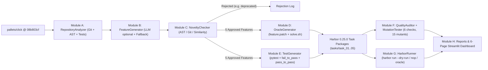

# FeatureForge AI — Technical Documentation

## 1. System Architecture & Workflow

FeatureForge AI implements a deterministic-first, self-auditing coding benchmark factory (`Modules A–H`) targeting `pallets/click` at commit `08b803cf32ceb2ae6a772c62d5da42757a897d44`.

---

## 2. Repository Analysis Methodology (`core/repository_analyzer.py`)

`RepositoryAnalyzer` inspects the local git clone (`repos/click`) without modifying any tracked file:
1. **Git Integrity Verification:** Runs `git rev-parse HEAD` (asserting 40-character SHA `08b803cf32ceb2ae6a772c62d5da42757a897d44`), `git status --porcelain` (asserting a clean working tree), and `git log -n 30`.
2. **AST Source Parsing:** Parses all 17 `.py` modules under `src/click/` (`12,823` lines) using Python's `ast` module, extracting every class, method, `__init__` parameter list, top-level function, import, and `__init__.py` public export.
3. **Test Suite Indexing:** Scans all 58 test files under `tests/` via AST to count `test_*` functions (`629` top-level test definitions, expanding to 2,543+ parametrized cases at runtime).
4. **Capability Gap Scan:** Matches candidate capability probes (regex patterns + AST `__init__` parameters + public exports + git commit subjects) against the codebase, saving structured output to `output/repository_analysis.json`.

---

## 3. Feature Opportunity Discovery (`core/feature_generator.py`)

`FeatureGenerator` generates six structured `FeatureProposal` specifications across distinct Click subsystems (`parameter-validation`, `command-routing`, `parameter-types`, `terminal-color`, `terminal-ui`, plus one intentionally redundant `command-metadata` candidate proposing `deprecated` to exercise the novelty gate).
- Each proposal defines all 8 required sections: `feature_title`, `problem_description`, `user_requirements`, `expected_behaviour`, `acceptance_criteria`, `technical_implementation_approach`, `new_feature_test_scenarios`, and `regression_test_requirements`.
- `LLMClient` (`core/llm_client.py`) reads `OPENAI_API_KEY` from the environment when `--llm` enrichment is enabled and automatically falls back to the deterministic local specification engine if disabled, unset, or unreachable.

---

## 4. Novelty Checking (`core/novelty_checker.py`)

`NoveltyChecker` never trusts LLM self-attestation; it programmatically verifies every candidate against five deterministic checks:
1. **Existing Functionality Detection:** Checks candidate `probe_symbols` against AST `__init__` parameter sets, `__init__.py` exports, and regexes over `src/click/*.py`. In the verified run, `candidate_existing` (`deprecated`) was rejected with exact symbol locations (`src/click/core.py::Command`, `Option`, `Parameter`).
2. **Duplicate Feature Detection:** Computes `rapidfuzz.fuzz.token_set_ratio` across approved proposals (threshold `< 75.0%`) and enforces distinct target subsystems.
3. **Requirement Completeness:** Verifies all 8 structured proposal fields are populated.
4. **Ambiguity Detection:** Scans requirement/criteria text for vague placeholders (`TBD`, `TODO`, `maybe`, `somehow`, `appropriately`, `etc.`).
5. **Acceptance Criteria & Test Alignment:** Enforces minimum criteria/scenario counts and presence of regression requirements.

---

## 5. Task Generation (`core/task_generator.py`)

For each of the 5 approved proposals, `TaskGenerator` builds an independent Harbor `0.25.0` directory (`tasks/task_01/`–`tasks/task_05/`) containing:
- `instruction.md`: Unambiguous specification with target files, requirements, expected behavior, acceptance criteria, and regression constraints.
- `task.toml`: Validated at generation time using `harbor.models.task.config.TaskConfig.model_validate_toml()`, recording `repository = "pallets/click"` and full 40-char `base_commit = "08b803cf32ceb2ae6a772c62d5da42757a897d44"`.
- `environment/Dockerfile`: `python:3.11-slim` image cloning `pallets/click` at the exact base commit and installing editable `click` + `pytest`.
- `solution/` and `tests/` artifacts from Modules D and E.

---

## 6. Reference Implementation Generation (`core/oracle_generator.py`)

`OracleGenerator` constructs clean, isolated reference implementations in the target language (Python) following Click's typing (`from __future__ import annotations`, `cabc`, `t`) and `gettext` (`_()`) conventions:
- Edits are applied to exact source anchors and converted into standard unified `git diff` patches (`solution/feature.patch`) via `difflib.unified_diff`.
- Note on backward compatibility: `tests/test_info_dict.py` asserts exact dictionary equality on `Option.to_info_dict()` and `Command.to_info_dict()`, so new metadata keys (`conflicts_with`, `requires`, `aliases`) are emitted conditionally only when configured.
- Generates `solution/solve.sh`, which checks and applies `feature.patch` using `git -c safe.directory="*" apply`.

---

## 7. Feature Test Generation & Regression Test Selection (`core/test_generator.py`)

- **Behavioral Feature Tests (`tests/test_feature_<slug>.py`):** Test observable CLI and API contracts via `click.testing.CliRunner`, `click.Context`, `click.ByteSize`, `click.format_table` / `click.echo_table`, and monkeypatched environment variables—avoiding internal implementation mirroring.
- **`tests/fail_to_pass.json`:** Extracted via AST parsing of `test_*` functions in each feature test module.
- **`tests/pass_to_pass.json`:** Selects the exact subsystem regression test files in `repos/click/tests/` (`test_options.py`, `test_defaults.py`, `test_info_dict.py`, `test_commands.py`, `test_chain.py`, `test_normalization.py`, `test_types/`, `test_basic.py`, `test_termui.py`, `test_compat.py`, `test_context.py`, `test_imports.py`).
- **`tests/test.sh`:** Runs both feature tests and regression tests via `pytest`, emits `1` / `0` to `/logs/verifier/reward.txt` and `{"reward": 1.0 | 0.0}` to `/logs/verifier/reward.json` (plus `verifier_details.json`), ensuring Harbor `Verifier` only sees finite numeric values in `reward.json`.

---

## 8. Mutation Testing (`core/mutation_tester.py`)

`MutationTester` clones `repos/click` into an isolated temp directory, applies `solution/feature.patch`, and injects **3 deliberate, targeted mutations per task** (15 total):
- `task_01`: Disable `conflicts_with` check, disable `requires` check, skip dash-to-underscore normalization.
- `task_02`: Disable alias match in `_resolve_alias`, bypass collision check in `add_command`, omit aliases from `format_commands`.
- `task_03`: Force binary base `1024` when `binary=False`, skip `min` bound check, accept `bool` inputs.
- `task_04`: Ignore `NO_COLOR`, ignore `FORCE_COLOR`, ignore explicit `ctx.color`.
- `task_05`: Replace `term_len` with raw `len`, disable `max_col_width` truncation, disable `grid` border branch.

Each mutant is executed against the task's `test_feature_*.py` suite; exit code `!= 0` marks the mutant `KILLED`. All 15/15 mutants were killed (`100.0%`).

---

## 9. Harbor NOP & Oracle Execution (`core/harbor_runner.py`, `core/harbor_local_env.py`)

1. **Preflight & Docker Probe:** Checks `harbor --version` (`0.25.0`) and `docker info`. When Docker is unavailable, executes one default `harbor run` probe to record the genuine host error without masking it.
2. **Harbor `0.25.0` Trials:** Runs `harbor run -p <task_dir> -a nop --dry-run -y`, `harbor run -p <task_dir> -a nop -k 1 -o ... --no-delete -y`, and `harbor run -p <task_dir> -a oracle -k 1 -o ... --no-delete -y`.
3. **Custom Local Environment (`LocalWorktreeEnvironment`):** Implements Harbor's `BaseEnvironment` interface (`start`, `stop`, `upload_file`, `upload_dir`, `download_file`, `download_dir`, `exec`) in isolated temp clones so Harbor's real `Trial`, `NopAgent`, `OracleAgent`, and `Verifier` execute on Windows without Docker.

---

## 10. Quality Assurance Strategy (`core/quality_auditor.py`)

Every task is gated across six checks before approval:
1. Requirement-test consistency (file completeness, `TaskConfig` validation, 40-char SHA match)
2. Feature coverage (fail on unpatched base commit, pass on patched commit)
3. Regression safety (`pass_to_pass` passes on both base and patched)
4. Mutation testing (100% mutant kill rate)
5. Test isolation (feature tests run in reversed node order)
6. Deterministic execution (two consecutive runs match in exit code and pass counts)

---

## 11. Error Handling & Robustness

- **Offline `langsmith` pytest plugin stall:** Sets `PYTEST_DISABLE_PLUGIN_AUTOLOAD=1` in test subprocesses so installed third-party pytest plugins cannot hang on offline network calls.
- **Git safe-directory & MSYS2 issues on Windows:** Uses native Python subprocesses and `git -c safe.directory="*"` in `LocalWorktreeEnvironment` instead of MSYS2 `bash.exe` (which fails under restricted Windows sandboxes with `NtCreateDirectoryObject` errors).
- **Rootdir collection walk:** Copies `test_feature_*.py` into the isolated temp worktree `tests/` directory before invoking `pytest` so `pytest` uses the repo's `pyproject.toml` rather than scanning parent workspace directories.

---

## 12. Limitations & Design Decisions

- **Docker Not Executed:** Host lacks Docker/WSL2 and admin rights; Docker container validation remains incomplete and is explicitly separated from `LocalWorktreeEnvironment` results.
- **Deterministic Core + Optional LLM:** Core patch/test generation is deterministic so tasks never fail due to flaky LLM syntax or offline environments, while `LLMClient` supports `OPENAI_API_KEY` enrichment when enabled.
- **Non-Destructive Base Repo:** All evaluations run in temporary copies; `repos/click` stays untouched at `08b803cf32ceb2ae6a772c62d5da42757a897d44`.
